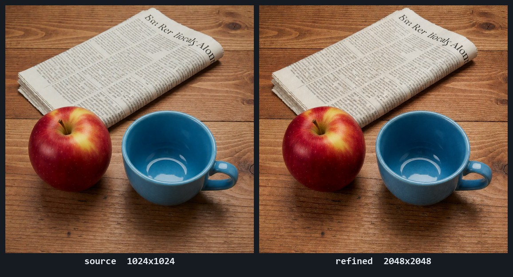
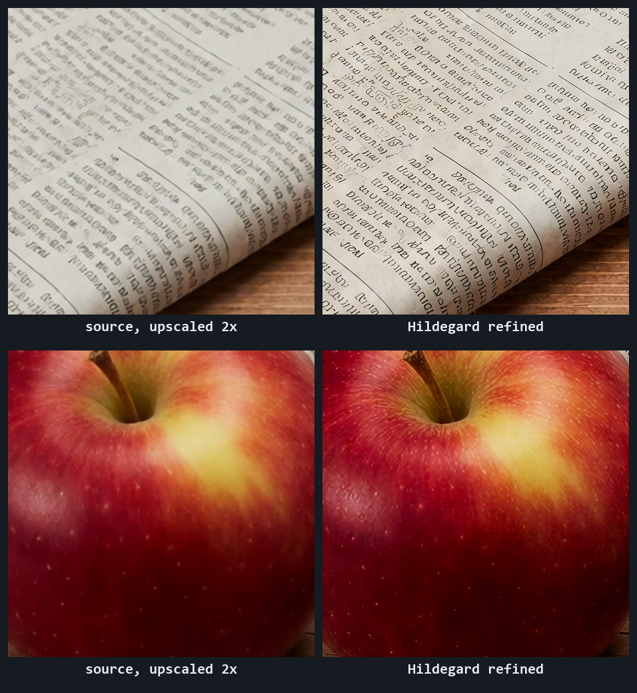
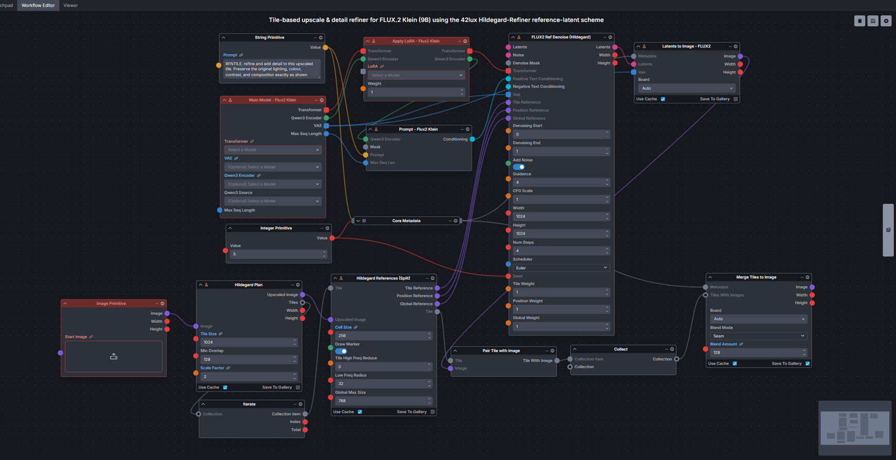

# FLUX.2 Klein Hildegard Refiner (InvokeAI custom nodes)

Port of the [42lux ComfyUI Hildegard-Refiner](https://github.com/42lux/ComfyUI-42lux-Hildegard-Refiner)
reference-latent scheme to InvokeAI, for tile-based refinement with FLUX.2 Klein.

## Compatibility

| InvokeAI | Branch |
|----------|--------|
| **7.x**  | [`main`](https://github.com/Pfannkuchensack/flux2_hildegard_refiner/tree/main) |
| 6.x      | [`v6`](https://github.com/Pfannkuchensack/flux2_hildegard_refiner/tree/v6) |

InvokeAI 7 changed the FLUX.2 denoise backend (the schedule is now shifted up front, so
`denoise()` no longer takes `mu`). Running the 6.x version of this node on 7.x fails with an
error about `mu`; update to `main`. If you are still on InvokeAI 6.x, use the `v6` branch.



A 1024² source refined to 2048² with `Tile Size 1024`, `Min Overlap 128`, `Scale Factor 2` —
nine tiles, four steps each. Composition, colour and lighting stay put; the detail is rebuilt.
At 100% the difference is the point:



Both crops are the same pixel region in both images — the source upscaled 2× on the left, the
refined result on the right. Note what each row shows: the apple gains real surface structure,
while the newsprint is **invented**, not recovered. A refiner cannot read text that was never
resolved in the source; it produces convincing letterforms where there was mush. Judge it on
texture, not on legibility.



The workflow bundled in [`example_workflows/`](example_workflows/) wires all three nodes together:
**Hildegard Plan** upscales and lays out the tile grid, **Hildegard References (Split)** produces the
tile / position / global reference images per tile, **FLUX2 Ref Denoise** refines each tile against
them, and Invoke's stock *Merge Tiles to Image* stitches the result back together.

## Nodes

### FLUX2 Ref Denoise (Hildegard) — `flux2_ref_denoise`

A fork of the stock `FLUX2 Denoise` node. Instead of the built-in
`kontext_conditioning` reference path (which clamps multi-reference images to
1024² and uses a fixed positioning scheme), this node exposes three explicit
reference slots that map 1:1 to the Hildegard three-latent scheme:

| Slot                 | Hildegard meaning                                   |
|----------------------|-----------------------------------------------------|
| **Tile Reference**   | VAE-encoded crop of the upscaled tile               |
| **Position Reference** | 3×3 neighbourhood / position map                  |
| **Global Reference** | Thumbnail of the whole upscaled image               |

Each slot has its own **weight** (resemblance ↔ creativity). References are
encoded at full resolution (no pixel clamp), packed, BN-normalized, and
concatenated as FLUX.2 reference tokens with `T = 10, 20, 30`.

The Hildegard **LoRA is mandatory** — load it onto the transformer (FLUX LoRA
loader) and include its trigger phrase in the prompt. Without it the model does
not understand these reference latents.

#### Typical wiring (single-tile de-risk experiment)

```
FLUX2 Main Model ─┐
FLUX LoRA (Hildegard) ─→ Transformer ─┐
Qwen3 prompt (RFNTILE. …) ────────────→ positive_text_conditioning
                                        FLUX2 Ref Denoise
  tile crop image  ──────────────────→ tile_reference
  global thumbnail ──────────────────→ global_reference
  FLUX2 VAE ─────────────────────────→ vae
                                        ↓ latents
                                        FLUX2 VAE Decode → Save
```

Leave `latents` unconnected for pure noise→refine (Hildegard's default), or feed
upscaled tile latents + `denoising_start` for an img2img-style pass.

## Status

Prototype / de-risking. The reference **positioning** mirrors Invoke's native
`Flux2RefImageExtension` (diffusers-aligned). If the LoRA misbehaves, the
positioning is the first knob to revisit.

## Credits and license

The reference-latent scheme is derived from the **GPL-3.0**
[ComfyUI-42lux-Hildegard-Refiner](https://github.com/42lux/ComfyUI-42lux-Hildegard-Refiner) by
**42lux** — specifically the three-latent reference layout (tile / position / global) and its
`T = 10, 20, 30` token offsets.

`FLUX2 Ref Denoise` additionally starts from InvokeAI's stock `FLUX2 Denoise` node (Apache-2.0,
© the InvokeAI contributors), with the built-in `kontext_conditioning` reference path replaced.
Apache-2.0 code may be combined into a GPL-3.0 work; the reverse is not permitted — which is why this
ships as a separate pack rather than as a patch to InvokeAI itself.

GPL-3.0. See [LICENSE](LICENSE). Original mechanism © 42lux, ComfyUI-42lux-Hildegard-Refiner.
